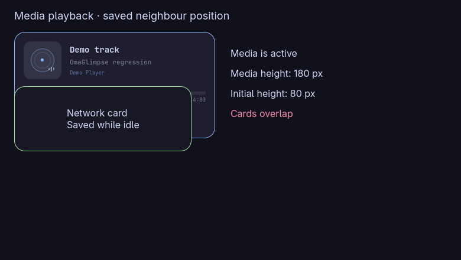
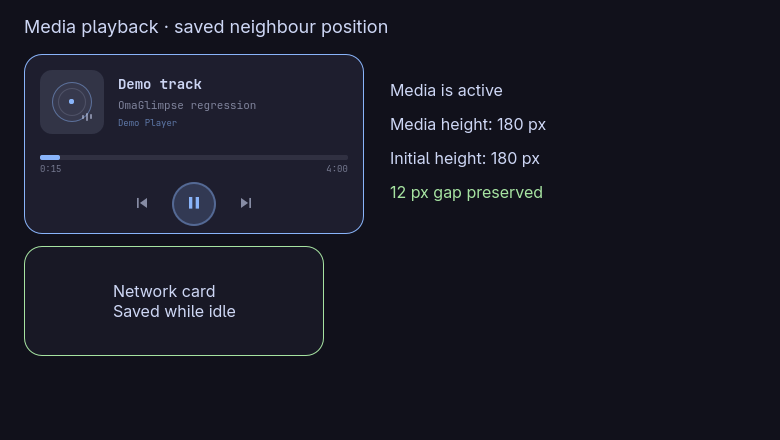

# Media card height regression captures

These captures load the actual upstream and patched MediaWidget.qml in an isolated offscreen Quickshell instance. A private D-Bus MPRIS demo player supplies neutral metadata, and minimal shell styling stubs isolate the component from the running desktop.

The neighboring card is positioned once below the media card while no media is available. It stays at that saved position when playback starts.

- Before: upstream 5ec7548 grows from 80 to 180 pixels and overlaps the neighbor.
- After: the patch reserves 180 pixels before playback and preserves the 12-pixel gap.
- With controls disabled, the patch reserves 122 pixels.

